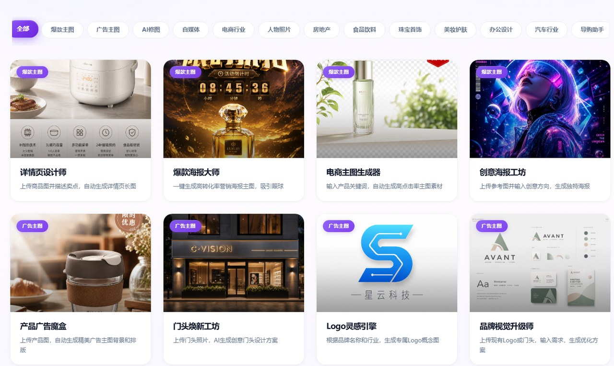
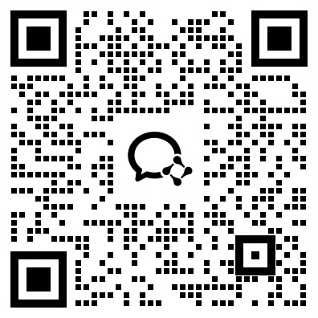

# 追光作图智能体

**按行业场景拆分的 AI 做图工具集**

电商主图 · 详情页 · 爆款海报 · 门头设计 · Logo 生成 · AI 修图

---

## 先看演示

**[👉 打开在线体验](https://zt.wazgz.com/)** —— 自动适配电脑与手机，无需安装。

> 在线站点为演示环境，部分功能需登录与积分；直接打开根地址即可，不用在网址后面加路径。

界面预览 · 实际功能以在线体验为准

---

## 它能做什么

不用自己琢磨提示词。选好行业和场景、传一张图，剩下的交给对应场景的智能体完成 —— 每个工具都是按具体出图需求调好的，不是通用聊天框。

**覆盖的行业与场景**

爆款主图 · 广告主图 · AI 修图 · 自媒体配图 · 电商行业 · 人物照片 · 房地产 · 食品饮料 · 珠宝首饰 · 美妆护肤 · 办公设计 · 汽车行业 · 导购助手

**代表性智能体**

| 智能体 | 用途 |
| --- | --- |
| 详情页设计师 | 商品详情页排版与卖点图 |
| 爆款海报大师 / 创意海报工坊 | 活动海报、营销主视觉 |
| 电商主图生成器 | 平台主图、白底图、场景图 |
| 产品广告魔盒 | 商品广告图 |
| 门头焕新工坊 / 装修灵感工坊 | 门店门头与空间效果 |
| Logo 灵感引擎 / 品牌视觉升级师 | 标识与品牌视觉方案 |

---

## 适合谁

| 你是 | 能用来做什么 |
| --- | --- |
| 电商商家 / 运营 | 主图、详情页、活动图自己出，不用等设计排期 |
| 设计 / 代运营服务商 | 批量出初稿，把时间留给精修 |
| 实体门店 | 门头、海报、促销物料快速出方案 |

---

## 源码出售

**本仓库只做产品介绍与演示，不包含任何程序文件。**

「追光作图智能体」**源码出售**。需要的话，扫码进群咨询，具体事宜群里聊。

源码与相关文件不会上传到公开仓库；在线站点仅用于功能展示。

---

## 进群咨询

**扫码进群 · 咨询源码与报价**

进群请备注「GitHub + 作图智能体」，方便快速对接

不方便扫码也可以直接加微信：**hgb2512**

---

## 追光系列其他产品

| 产品 | 定位 | 在线体验 |
| --- | --- | --- |
| 追光超级爆款 | 视频 / 图片 / 数字人一站式生成 | [打开](https://zgz.wazgz.com/) |
| 追光 IP 视频智能体 | IP 内容运营、剪辑混剪、多平台发布 | [打开](https://ip.wazgz.com/) |
| 追光作图智能体 | 电商与营销场景的智能出图 | [打开](https://zt.wazgz.com/) |

---

## 说明

- 三个站点相互独立，账号、作品与积分不互通。
- AI 生成结果请自行核对后再商用；涉及品牌素材、人物肖像的内容，请确认已获得相应授权。
- 在线服务与产品咨询由运营方提供，本仓库不收集任何账号信息。

苏ICP备2026009170号 · 本仓库仅作产品介绍与演示入口，不含源代码

